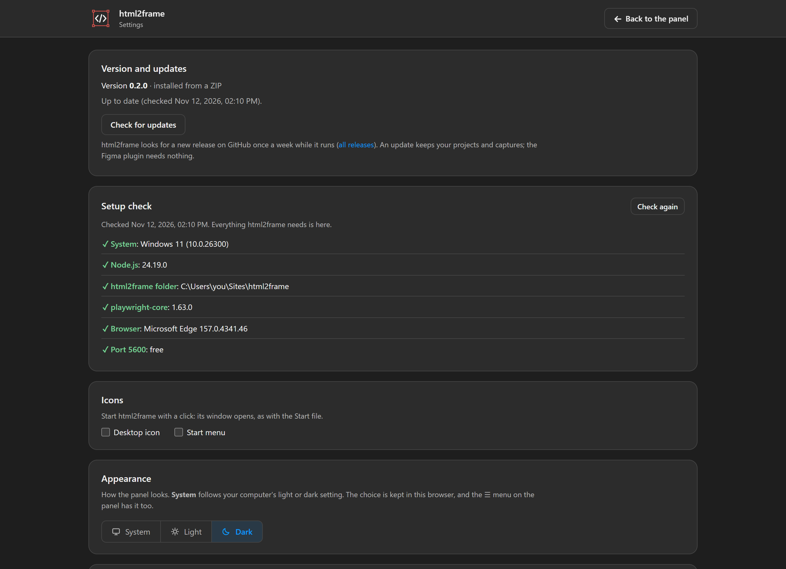
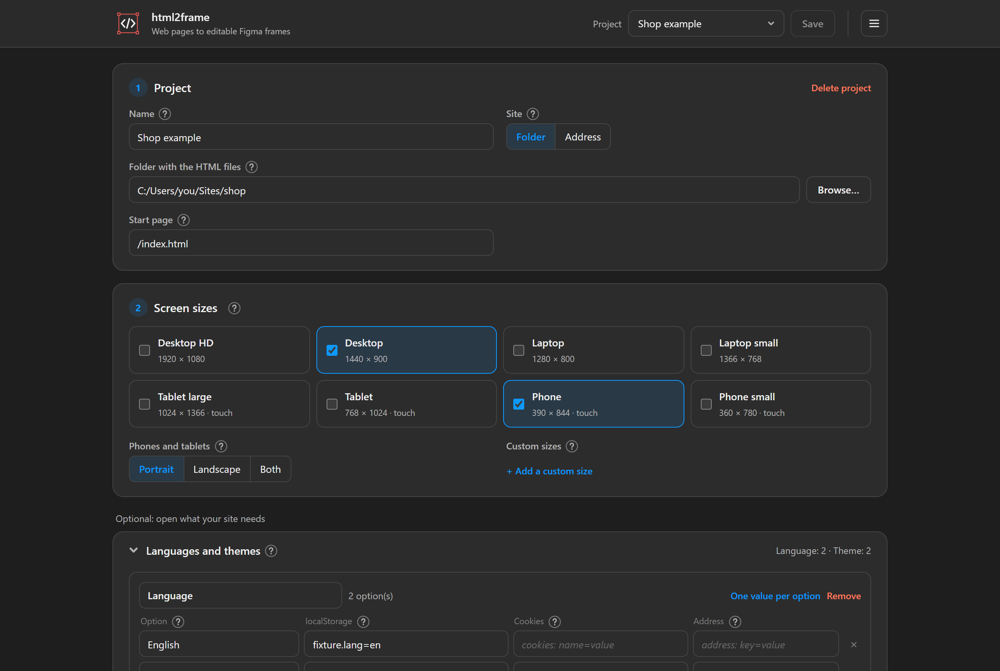
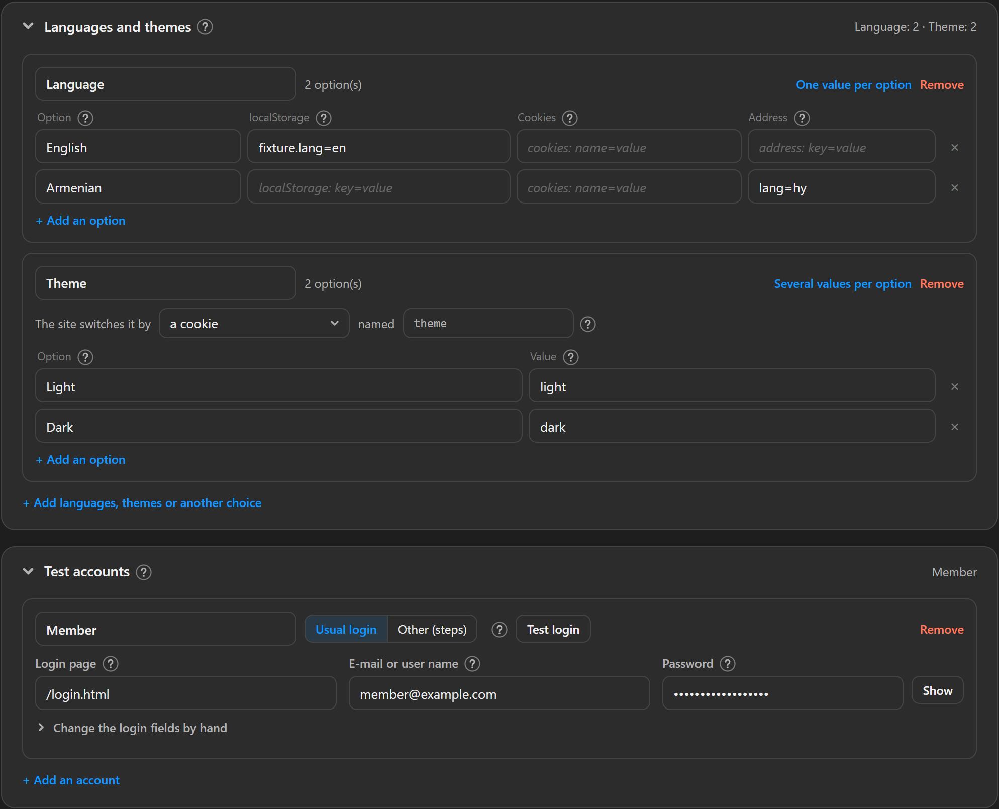
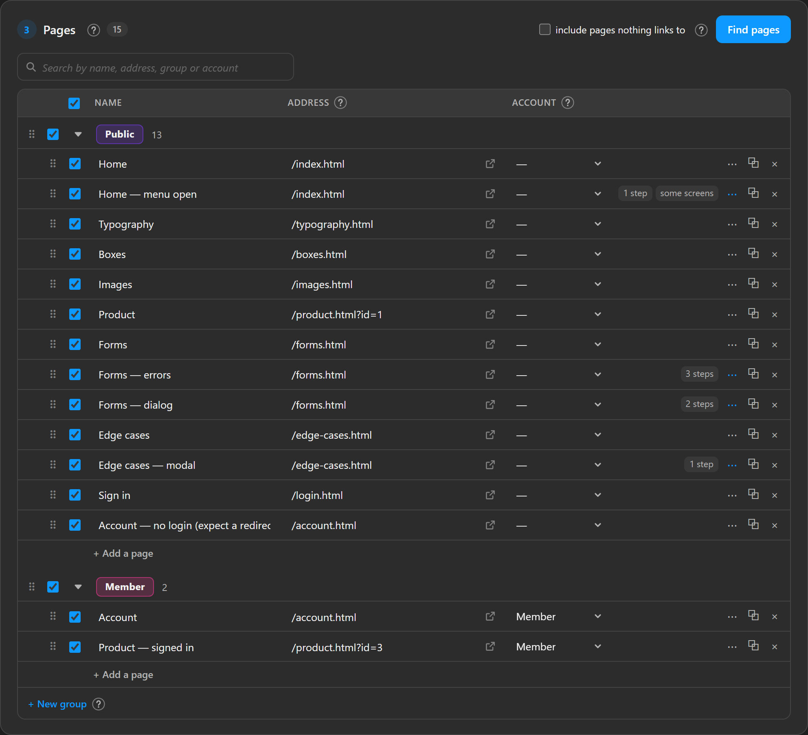
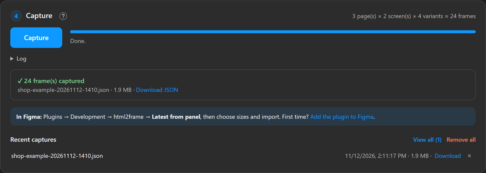
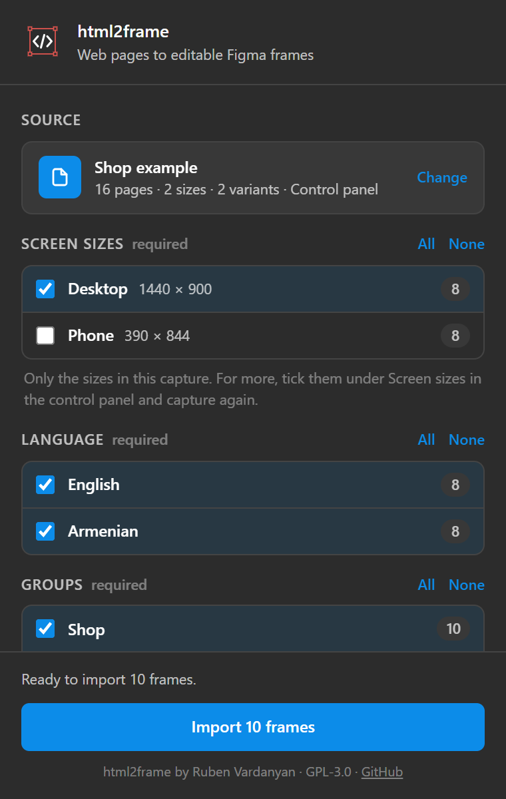

<p></p>

# html2frame

**HTML to Figma, website to Figma:** turn the pages of a website into **editable Figma designs**: real frames,
text layers, vectors and images (not screenshots), at the screen sizes you choose (desktop, laptop, tablet,
phone), in every language and theme of the site, including pages behind a login.

**[⬇ Download the latest version](https://github.com/Ruben-Vardanyan/html2frame/releases/latest)**
(under *Assets*, **Source code (zip)**) · [How to install](#install) ·
[Report a problem](https://github.com/Ruben-Vardanyan/html2frame/issues)

- Works on the **free Figma plan**: the importer is a Figma plugin you load in the desktop app.
- Everything runs **on your computer**: your site, its test logins and the captures never leave it.
- Windows and macOS: download, double-click **Start**, and the first start checks your computer for you. (On
  Linux, run `npm install && npm start` and open http://localhost:5600 yourself.)

```
your site ──► real browser (capture) ──► JSON (boxes, text, fonts, vectors, images) ──► Figma plugin ──► frames
```

Figma cannot open HTML, so html2frame renders each page in your installed Edge or Chrome, measures everything
that is painted, and the plugin rebuilds it in Figma node by node.

## Contents

1. [What you need](#what-you-need)
2. [Install](#install)
3. [Stop, settings and updates](#stop-settings-and-updates)
4. [Capture a site with the control panel](#capture-a-site-with-the-control-panel)
5. [Import into Figma](#import-into-figma)
6. [Command line](#command-line)
7. [What comes through](#what-comes-through)
8. [Troubleshooting](#troubleshooting)
9. [Report a problem](#report-a-problem)
10. [Remove html2frame](#remove-html2frame)
11. [For developers](#for-developers)

## What you need

| | |
|---|---|
| **Windows 10 or 11, or macOS 12 or newer** | Edge and Chrome no longer run on older systems. |
| **Node.js 20 or newer** | [nodejs.org](https://nodejs.org) (the LTS version). On macOS also `brew install node`. |
| **Microsoft Edge or Google Chrome** | Already installed on most computers. html2frame uses it; it downloads no browser of its own. |
| **Figma desktop app** | Any plan, including free. The browser version of Figma cannot load development plugins. |
| **Your site** | A folder of HTML/CSS/JS files, or an address of a running site such as `http://localhost:3000`. |

## Install

1. **Download html2frame:** open the [latest release](https://github.com/Ruben-Vardanyan/html2frame/releases/latest)
   and, under *Assets*, click **Source code (zip)**. Extract it (Windows: right-click the ZIP → **Extract All**;
   macOS: double-click it) and keep the folder somewhere of your own, such as Documents. (**Code → Download ZIP**
   on the repository page also works, but it gives the newest code on `main`, which may not be released yet.)
   Developers can `git clone https://github.com/Ruben-Vardanyan/html2frame.git` instead.
2. **Start it:** in the folder, double-click
   - **Windows:** **Start (Windows)** (`Start (Windows).bat`);
   - **macOS:** **Start (macOS)** (`Start (macOS).command`). The first time, macOS says it cannot verify the file.
     On macOS 15 and later: **System Settings → Privacy & Security**, then **Open Anyway** next to the message.
     On macOS 12–14: right-click the file → **Open** → **Open**.
3. **The first start checks your computer:** the system version, Node.js, Edge or Chrome, the folder and port
   5600, and it installs one package (`playwright-core`, about 14 MB; no browser download). When something
   important is missing it says what to do, e.g. *"Node.js is missing. Please install Node.js 20 or newer from
   https://nodejs.org"*, and stops: nothing is installed or opened for you. Then it asks two questions, each with
   **Y** or **N**: an html2frame icon on the **Desktop**? In the **Start menu** (macOS: in **Applications**)?
4. **The panel opens** in your browser at **http://localhost:5600**. The window stays open: html2frame runs in it,
   and it says how to stop it. Next time, click the **html2frame** icon (or the Start file): the window opens and the
   panel opens at once. The check only runs again when something changed, such as a new Node.js or a new html2frame
   version.
5. **Load the Figma plugin (once):** Figma desktop app → **Plugins → Development → Import plugin from manifest…**
   → choose **`figma-plugin/manifest.json`** in this folder. The panel's **Help** page walks you through it for
   Windows and macOS, with the full path to copy and a button that shows the file in Explorer / Finder.

## Stop, settings and updates

html2frame runs in its window until you stop it: press **Q** in that window, **Quit** at the top of the panel
(in the **☰** menu) or in **Settings**, or close the window. **O** in the window opens the panel in your
browser again. Quit also stops a capture that is running, closes the browsers it
started and closes that window; the panel's tabs show "html2frame has stopped" (and close, where the browser allows
it). Closing only the browser tab doesn't stop html2frame, so Figma's **Latest from panel** keeps working.

The **Help** page (in the **☰** menu at the top right of the panel) shows how to add the plugin to Figma and the common problems, with a list of
its sections at the side (at the top on a phone); each problem opens its answer with a click. **About** (in the
footer, and **Report a problem** in the ☰ menu) has the version, the licence and Report a problem.

**Settings** (in the ☰ menu):

- **Version and updates:** html2frame looks for a new
  [release](https://github.com/Ruben-Vardanyan/html2frame/releases) once a week while it runs, and a dot on Settings
  shows when there is one, with its notes (*What's new*). **Update now** downloads that release, replaces the
  program files, keeps your projects and captures, and starts html2frame again. The old files are kept in
  `.html2frame/backup/`, and if anything goes wrong the old version is put back. If you installed with git, Update
  now moves the folder to the release (`git fetch --tags`, `git merge --ff-only v…`), but only on the `main` branch
  with no changed files and no commits of your own; otherwise Settings says why and shows the command to run yourself.
- **Setup check:** the last check of this computer, and **Check again**.
- **Icons:** add or remove the Desktop icon and the Start menu (macOS: Applications) entry.
- **Appearance:** System (follows your computer), Light or Dark.


- **Figma plugin:** the manifest's path, to copy or to show in Explorer / Finder.

This computer's own html2frame files (the check, the icon answers, the logs, the update backup) are in the
`.html2frame` folder inside the html2frame folder.

## Capture a site with the control panel

The panel is one page with four numbered cards, and between cards 2 and 3 a few optional sections that stay
closed until your site needs them. Changes are saved with **Save**, which turns amber while something is not
saved yet (capturing saves too). The theme switch picks the panel's look: the same as your system,
light or dark. Help, Settings, Report a problem, Quit and that switch are in the **☰** menu at the top right; the
switch is also in **Settings → Appearance**.



**1. Project.** Open the project list at the top and choose **+ New project** (its last line), give the project
a name and choose the **folder** with your HTML files
(**Browse…** opens your system's folder window: Explorer on Windows, Finder on macOS) or the **address** of a
running site. *Start page* is where finding pages begins (usually `/index.html`). **Delete project** moves the
project file to `projects/deleted/`, from where you can bring it back.

**2. Screen sizes.** Tick the sizes you want: desktop HD, desktop, laptops, tablets and phones, plus custom
sizes (tick **touch** for a custom size that should behave like a phone or tablet). For phones and tablets choose
**portrait**, **landscape** or **both**; they are captured as touch devices. With no size ticked, the capture uses
Desktop and says so.

**Optional sections.** Each one shows in its closed row what is set; open only what your site needs.



- **Languages and themes**: something the site can switch, such as *Language* or *Theme*. Say how the site
  switches it (by localStorage, a cookie or the address, and under which name), then add one row per option with
  a label and a value, e.g. *English* = `en`. Every combination is captured: 2 languages × 2 themes = 4 versions
  of each page. **Several values per option** gives each option its own free fields, for a site that needs more
  than one value (or different names) per option.
- **Test accounts**: an account logs in before the pages that need it, and Find pages also follows the links you
  only see when logged in. Enter the login page, the e-mail and the password, and click **Test login** (it
  saves the project first): it shows where it landed, with a screenshot, and finds the login fields by itself if
  the usual names don't work.
  **Change the login fields by hand** holds them if you need to. For special logins (extra fields, two steps),
  switch the account to **Other (steps)**. Passwords stay in the project file on your computer
  (`projects/*.json`, never uploaded and not committed to git).
- **Local storage**: values set before every page opens, in every language, theme and account: for example a
  saved cart or comparison list, so the pages that read it are captured with content. Write each value exactly as
  the site stores it (look in the browser's developer tools, Application → Local Storage), e.g. `[{"id":3}]` or
  `"en"`. **Table** shows one row per value; **Bulk** shows them all as text, one `key=value` per line, to paste
  many at once. A value that starts with `[` or `{` but is not valid JSON is marked red; quotes around pasted
  JSON (`'[{"id":3}]'`, as copied from code) are dropped. A language or theme option's own value for the same key
  wins.
- **Loading**: for sites that draw their content with JavaScript and come out half drawn. **Wait until** adds
  conditions such as "this is on the page" (a CSS selector) or "the page no longer has this class", joined by
  *All of these* or *Any of these*; *Extra wait after ready* pauses a little longer. Leave it empty if unsure.
- **Replace text**: e.g. find `֏`, replace with `AMD`, when a font in Figma lacks a character. **Table** or
  **Bulk** (one `from=to` per line), as in Local storage.

**3. Pages.** Click **Find pages**: html2frame opens the site, follows its links (as a guest, then logged in
with each account) and fills the list. Pages that only differ by an id (`product.html?id=1…50`) are listed once,
as "+N similar". For a folder site, tick **include pages nothing links to** to also list the `.html` files no
link leads to (they go into the group "Not linked"). **Cancel** stops it; nothing is added then.



The list is shown in groups, like a task list; each group becomes a row in Figma, or its own section. Untick
pages you don't need (the box in a group's header ticks the whole group; while you search, the box at the top
ticks only the pages shown), rename them, or click a group's name to rename the group. The arrow before a group
folds it; an empty group has its own **×**. Drag a page by its **⠿** handle to reorder it or to move it into another group, and drag a group
by its handle to reorder the groups; pages are captured in this order. **+ Add a page** at the end of a group adds
one right there (type the name and address, then Enter); **+ New group** at the end of the list adds an empty
group. **Search** finds pages by name, address, group or account, also among the "similar" addresses. **↗** next
to an address opens the page in your browser (as a visitor). The row buttons: **⋯** steps before the capture
(e.g. *Click* `.menu-button` for an open menu, or *Type into* a form to show its errors; **Edit as JSON** if you
prefer) and the screen sizes the page is captured on (a "menu open" state only on phones, where the burger button
shows; none ticked = all), **⧉** add a state of the page (the same page after some steps), **×** remove.

**4. Capture.** Click **Capture** and follow the progress; **Cancel** stops it without saving anything. The
estimate shows how many frames you will get. While a capture or Find pages runs, the settings are locked (the
search and the logs still work). Under **Recent captures**, **×** moves one capture file to the Recycle Bin
(Trash on macOS) and **Remove all** moves all of them, also the older ones not listed, so you can bring one back
from there. The list shows the 8 newest; **View all (N)** lists every capture with a search, filters by project and
date, a download per file and **Remove shown (N)**. **Download JSON** under a finished capture saves the file, e.g. to
send it to somebody.



## Import into Figma

1. In the Figma desktop app, open a design file and run **Plugins → Development → html2frame**.
2. Click **Latest from panel** (html2frame must be running), or **Choose file** for a saved capture
   (`captures/*.json`, or one somebody sent you; several at once, or drop them on the window).
3. Tick the **screen sizes** to import, and the **languages, themes** and **groups** when the capture has more
   than one (each list is named after what it holds, e.g. *Language*, *Theme*; **All** / **None** tick a whole
   list). Nothing is ticked at first; the button shows how many frames you will get ("Import 12 frames").
4. Choose the **layout**:
   - **One page**: everything on the current Figma page, in **Sections**;
   - **Page per screen**: a Figma page for each screen size and variant ("Desktop — English · Dark").
   - **Sections**: **Screen** (the default: a section per screen size, a row per group), **Group** (a section
     per group, e.g. "My pages", with a row per screen size; with several languages or themes, one per variant
     too) or **Group + screen** ("My pages — Desktop", "My pages — Phone portrait"; not offered with *Page per
     screen*, where it would be the same as Group). Groups come from the panel's page list.
   - **Use Auto Layout** (off at first): flex rows and columns (navigation, buttons, cards) become Auto Layout
     frames where Auto Layout reproduces the page exactly; everything else keeps its exact position.

   The plugin remembers these choices.
5. Click **Import**. A report lists the frames per section, fonts that were replaced, and any warnings.



After an import the button shows **Imported ✓** and waits until you change the ticks or the layout, so the same
frames aren't added twice by accident. Importing again adds the new frames below the existing ones; nothing is
overwritten.

## Command line

Everything the panel does is also available in a terminal (from this folder):

```bash
node src/capture.js projects/mysite.json --screens desktop,phone --orientation both
node src/capture.js C:/path/to/site --screens desktop --save projects/mysite.json
node src/crawl.js projects/mysite.json --save projects/mysite.json
```

- `capture.js <settings.json | folder>`: `--screens`, `--orientation`, `--pages "Home,Log In"`, `--out file.json`;
  with a folder every `.html` file becomes a page (`--save` keeps the generated settings, `--ready "js"` sets
  a JavaScript condition to wait for, like the panel's *Wait until*).
- `crawl.js <settings.json | folder>`: finds pages by following links; `--save` adds them to the settings file,
  `--unlinked` also adds files nothing links to, `--depth`, `--max`.
- `node src/start.js` is what the Start files run (the check, then the panel in the same window);
  `node server.js [--open] [--port 5600] [--log]` starts the panel itself, in the terminal.

The settings file format is described in [`docs/PLAN.md`](docs/PLAN.md) (*Settings file*), the capture format
in [`docs/FORMAT.md`](docs/FORMAT.md).

## What comes through

- **Layout and boxes:** positions, sizes, background colours, borders (per side, dashed), corner radii, shadows,
  opacity, clipping, linear and radial gradients, background images, CSS `clip-path` (as masks), rotate/scale/mirror/translate
  transforms, blur, background blur and blend modes.
- **Text:** editable text layers with font, weight, size, line height, letter spacing, colour, alignment,
  decoration, case, text shadow and gradient text; a paragraph with links or bold words is one layer with styled ranges;
  `sans-serif`, `serif` and `monospace` become the font the browser used (e.g. Arial); multi-column text;
  vertical text. Each script gets a suitable font: for
  Armenian, the site's Armenian font if Figma has it, otherwise Calibri (then other Armenian fonts).
- **Vectors and images:** inline SVG (including `<use>` sprites) as editable vectors; SVG, PNG, JPEG, GIF and
  WebP images (also when the file name says otherwise); icon fonts such as Font Awesome as images; canvas,
  video and iframes as images; CSS 3D scenes (perspective, spinning rings) as one picture each, since Figma has
  no perspective.
- **Forms:** values, placeholders, password dots, selects, checkboxes, radios, toggles and file inputs.
- **Charts:** SVG stroke dashes as real geometry, so donut charts and progress rings look right.
- **Layer order:** layers follow the browser's paint order (`z-index`, positioned and overlapping elements), and
  open dialogs, popovers and fullscreen elements (the "top layer") come out on top.
- **Line breaks** stay where the browser put them, also when Figma's text measures slightly differently.
- Text that is only there for screen readers (visually hidden) leaves no layer.
- **Lists and details:** bullets, numbers and the triangles of `<details>`.
- **Not (yet):** conic and repeating gradients, CSS counters, skew transforms, CSS filters other than blur
  (brightness, grayscale…: Figma has no equivalent), text that overflows its box with an ellipsis, and Auto Layout
  for plain stacked blocks or grids. The test site's *Edge cases* page
  ([`test/site/edge-cases.html`](test/site/edge-cases.html)) shows each case and what Figma should show.

## Troubleshooting

| Problem | What to do |
|---|---|
| **"Extract the ZIP first"** | You opened the Start file inside the ZIP. Extract the ZIP (right-click → **Extract All**) and start it from the extracted folder. |
| **"Node.js is missing"** or **"Node.js 18… is too old"** | Install Node.js 20 or newer (the LTS version) from [nodejs.org](https://nodejs.org), then start again. |
| **"html2frame needs Windows 10 / macOS 12 or newer"** | Edge and Chrome no longer run on that system; use a newer computer or system. |
| **"Microsoft Edge or Google Chrome … neither could start"** | Install one of them (any recent version), then start again. |
| **"Port 5600 is used by …"** | The check names the program. Close it: the Figma plugin can only reach html2frame on port 5600. (When it is html2frame itself, the panel simply opens.) |
| **macOS: "Apple could not verify Start (macOS)"** | macOS 15+: System Settings → Privacy & Security → **Open Anyway**. macOS 12–14: right-click → **Open** → **Open**. If it opens in a text editor: `chmod +x "Start (macOS).command"` in Terminal. |
| **An update did not work** | Settings says why; the old version was put back. The details are in `.html2frame/logs/update.log`. |
| **Pages come out half drawn or empty** | The site draws with JavaScript: open **Loading** and set **Wait until** (or a longer *Extra wait*). |
| **"Wait until was not true … captured anyway"** | The condition in **Loading → Wait until** does not fit this site (e.g. copied from another project): fix or clear it. |
| **A login page instead of the account page** ("landed on /login.html") | Check the test account with **Test login**; choose the account in the page's **Account** column in the page list. |
| **"content is 469px wide on a 390px screen"** | The page itself overflows sideways on that screen (a real responsive bug on the site). The frame keeps the screen width. |
| **Armenian (or other) text missing in Figma** | Install the site's font, or Calibri. The import report lists the fonts it used. |
| **"html2frame is not running"** in Figma | Start it from its icon or the Start file, or use **Choose file**. |
| **Big capture files** | Every frame carries its images; capture fewer pages, screens or variants at once. |

## Report a problem

Problems and ideas go to [GitHub Issues](https://github.com/Ruben-Vardanyan/html2frame/issues) (a free GitHub
account is needed). The easiest way is **Report a problem** in the panel's ☰ menu (or footer → About): **Report a problem on GitHub**
opens the form with your setup already filled in: the html2frame, system, Node.js and browser versions, never folder
paths, projects or passwords. **Suggest an idea** opens the form for ideas. Reports on GitHub are public: don't paste
passwords or attach pages that must stay private.

## Remove html2frame

1. **Settings → Icons:** untick the icons, so none is left pointing nowhere.
2. **Quit** html2frame.
3. Delete the html2frame folder. Your projects and captures are in it (`projects/`, `captures/`): move them
   elsewhere first if you want to keep them.
4. In Figma: **Plugins → Development → Manage plugins in development**, then remove html2frame.

## For developers

- Plain JavaScript, no build step, Node 20+ (`playwright-core`'s minimum), one dependency (`playwright-core`).
- Read [`CLAUDE.md`](CLAUDE.md) and [`docs/PLAN.md`](docs/PLAN.md) first; decisions are in
  [`docs/DECISIONS.md`](docs/DECISIONS.md), lessons learned in [`docs/RESEARCH.md`](docs/RESEARCH.md).
- Tests: `node test/mock-figma.js` (the plugin against a fake Figma API),
  `node src/capture.js examples/fixture.settings.json` (the test site in [`test/site/`](test/site/README.md)),
  `node test/compare-capture.js a.json b.json` (page sizes of two captures) and `node test/trash.js` (moving files
  to the Recycle Bin / Trash on this computer).
- The setup check's messages can be tried without breaking anything: `HTML2FRAME_FAKE_NODE=18`,
  `HTML2FRAME_FAKE_OS=win32:6.1` or `darwin:11.7`, `HTML2FRAME_FAKE_NO_BROWSER=1`, and `HTML2FRAME_PORT=5601` to check
  and start next to a running panel (`src/setup.js`). `HTML2FRAME_FAKE_UPDATE_FAIL=src/x.js` makes an update fail
  on that file, to see the old version put back (`src/update.js`).
- Releasing: versions follow [Semantic Versioning](https://semver.org) (`MAJOR.MINOR.PATCH`: fixes raise PATCH, new
  features MINOR, changes that break old captures or settings MAJOR). Raise `version` in `package.json` (and
  `package-lock.json`) in the change that is released, merge it to `main`, then on GitHub **Releases → Draft a new
  release**: tag `v` + that version (e.g. `v0.3.0`) on `main`, a title, notes (they become *What's new* in
  Settings), **Publish release**. Only a published release reaches the users' update check; drafts and pre-releases
  don't, and neither does work merged to `main` in between. `HTML2FRAME_RELEASE_API=<url>` points the check at
  another "latest release" address, to test an update without publishing one (`src/update.js`).

## License

html2frame is free software: © 2026 Ruben Vardanyan, under the [GNU General Public License v3](LICENSE) or later.
You may use, change, share and sell it. Whoever passes html2frame on, changed or not, free or paid, must give the
full source code under the same license, and keep the credit **"html2frame by Ruben Vardanyan"** with the link to
this repository, visible in the panel's About page and the plugin window (an additional term under GPL section
7(b), in [`NOTICE`](NOTICE)).
